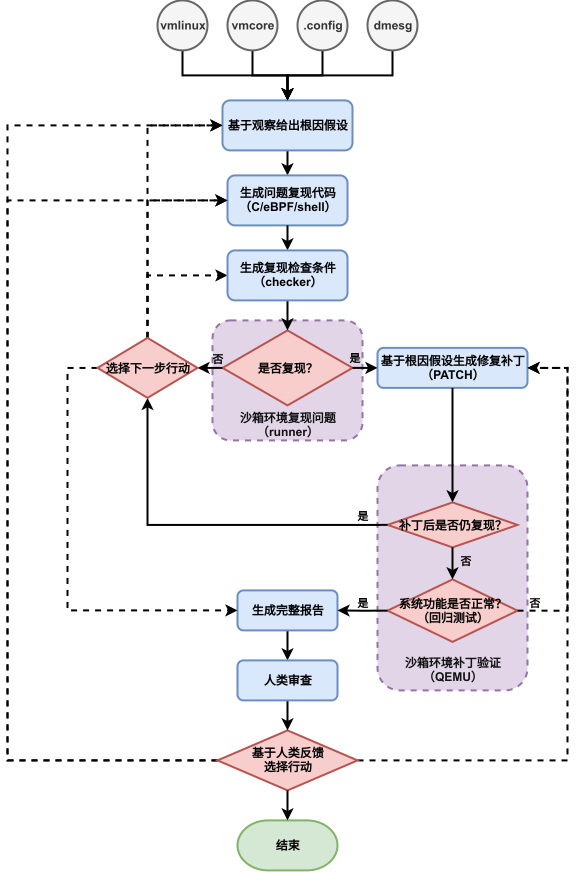

# kdebugent 技术方案

- 版本：v0.4（草案）
- 日期：2026-10-19
- 状态：草案，欢迎讨论

---

## 目录

1. [背景与动机](#1-背景与动机)
2. [目标与非目标](#2-目标与非目标)
3. [相关工作与定位](#3-相关工作与定位)
4. [核心方法论](#4-核心方法论)
5. [总体架构](#5-总体架构)
6. [流程与节点设计](#6-流程与节点设计)
7. [Checker 规范](#7-checker-规范)
8. [沙箱与构建系统](#8-沙箱与构建系统)
9. [人机协同](#9-人机协同)
10. [报告规范](#10-报告规范)
11. [评估方案](#11-评估方案)
12. [里程碑](#12-里程碑)
13. [风险与开放问题](#13-风险与开放问题)
14. [决策记录](#14-决策记录)

- [附录 A：输入清单与一致性校验](#附录-a输入清单与一致性校验)
- [附录 B：产物目录布局](#附录-b产物目录布局)
- [附录 C：术语表](#附录-c术语表)
- [附录 D：参考资料](#附录-d参考资料)

---

## 1. 背景与动机

### 1.1 现有根因分析工具的共同缺陷

#### 1.1.1 纯推理给出根因缺少客观评判

当前面向 Linux 内核的 LLM 根因分析（RCA）工具，无论工业界还是学术界，主流形态都是：

> 读取崩溃材料（dmesg / vmcore / 调用栈）→ 推理 → 输出根因假设和置信度。

例如阿里云的 vmcore AI 诊断（drgn 加 AI 推理）、Cloudflare 的崩溃自动分析 agent，均属此类。学术界的 KernelDiag（arXiv:2607.17722）用证据图做结构化因果推理，是纯推理路线目前的最好水平——其方法级定位 Top@1 准确率为 **33.3%**（文件级 65.9%）。这个数字说明，纯推理路线远远不够可靠。

这类方案的根本问题在于：**置信度是 LLM 对自己的主观估计，不是对结论的实验检验。**

#### 1.1.2 复现程序验证归因不彻底

有的方案除了有主观推理，也会让 LLM 通过某些复现程序验证根因假设是否正确，试图让根因假设更加可靠。然而，即便 agent 给出了复现程序并成功复现了 bug，也不能证明归因正确：**多个不同的根因，可能通过同一个复现程序复现出同一个现象。** 复现验证的是“症状可以被触发”，不是“归因正确”。一个 NULL 指针崩溃，可能源于竞争窗口 A，也可能源于缺失检查 B——两者都能让复现程序稳定崩溃，而它们的解法可能会有所不同。

### 1.2 核心思路：减少主观、增加客观

#### 1.2.1 原则1：用修复补丁验证根因

基于对已有方案的反思，kdebugent 选择将根因分析进一步定量化、提供确定性判据：

> 与其估计“根因假设有多可信”，不如对假设中的“因”直接施加干预——生成修复补丁——然后观察“果”（问题现象）是否消失。

**只有知道解法是正确的，才能确认根因分析是正确的。** 补丁让问题不再复现、且系统功能没有回归，根因才获得了实验层面的支撑。这样，结论就从“带置信度的猜测”变成了“经过实验检验的因果判断”。判断环节不再有 LLM 参与，从机制上避免了幻觉影响判断。

> [!TIP]
> 当然可以说找到解法也不代表根因正确，因为可能多个归因可以由一个解法解决。但是在这种情况下，根因究竟是否准确已经无关紧要了：我们已经找到了规避这个问题的方法了，已经从实用角度将问题解决。

#### 1.2.2 原则2：把判断从 LLM 手里拿走

仅有干预闭环还不够。流程中每一个“是否”的判定（是否复现、是否解决、回归是否通过），都不允许 LLM 读日志“觉得对或错”，而必须是机器可以重复执行的判据。我们把这份判定标准的执行者称为 **checker**（检查器）：它回答“观察到什么现象，才算 bug 出现”。相应地，复现程序由两部分组成——**触发器**（trigger，制造触发条件）和**检查器**（checker，判定现象是否出现）。测试理论文献里对应的概念叫 test oracle（测试预言），本方案选用 checker——更直白，且与硬件验证界及内核社区（checkpatch、sparse）的用语一致。

- **LLM 负责生成**：根因假设、触发器代码、checker 判定规格（结构化 JSON，见第 7 章）、修复补丁；
- **机器负责判定**：runner 按 checker 规格对运行结果求值，输出 PASS/FAIL 及证据。

这一原则与硬件验证中的 checker 思路相同：把“判定”从智能组件中拿出来，交给确定性的程序。硬件验证方向的 UCAgent 项目（https://github.com/XS-MLVP/UCAgent ）中的 checker 组件就是这种做法——事先定义规格，由确定性程序验证——只是它的检查停留在语法、格式等静态层面；kdebugent 的 checker 进一步对运行结果做动态判定。

---

## 2. 目标与非目标

### 2.1 目标

| 维度     | 范围                                                                                                            |
| -------- | --------------------------------------------------------------------------------------------------------------- |
| 问题域   | Linux 内核 bug 的根因追查，以**调度子系统**问题为首个切入点                                                     |
| bug 类型 | **崩溃类**（panic/oops/BUG_ON）与**行为类**（延迟、饥饿、负载不均、带宽控制异常等）并行设计，崩溃类先行打通     |
| 架构     | x86_64、aarch64 等，架构差异由 ArchProfile（架构档案，见附录 C）抽象承载，后续可扩展更多架构（x86_64 先行支持） |
| 输入     | vmlinux、vmcore、.config、dmesg、**内核源码树（含 git 历史）**、模块 .ko（若涉及）；可选自带复现程序            |
| 输出     | 经协议验证的根因结论 + 修复补丁 + 全程可审计的报告                                                              |

### 2.2 非目标

- 安全漏洞的挖掘与利用（fuzzing、exp 生成）；
- 非内核问题（用户态程序、分布式系统 RCA）；
- 硬件相关 bug（需要真机或特定硬件才能触发的问题）——这类问题会如实判定为复现失败并生成报告。

---

## 3. 相关工作与定位

| 工作                                           | 输入                                            | 复现程序                       | 补丁 | 验证方式                                           | 行为类 bug | 人审回路 |
| ---------------------------------------------- | ----------------------------------------------- | ------------------------------ | ---- | -------------------------------------------------- | ---------- | -------- |
| KernelDiag（天津大学, 2026, arXiv:2607.17722） | syzbot 崩溃报告 + syscall + 日志                | 自带（syz repro）              | ✗    | 无（纯推理 + 证据图）                              | ✗          | ✗        |
| kAgent（Google, ICML'26 WS, arXiv:2504.20412） | syzkaller 日志 + **已有 repro**                 | 自带                           | ✓    | crash 复现与否（单次判定）                         | ✗          | ✗        |
| 阿里云 vmcore AI 诊断                          | vmcore（drgn）                                  | ✗                              | ✗    | 无（置信度）                                       | ✗          | ✗        |
| Cloudflare 崩溃分析 agent                      | fleet crash dump                                | ✗                              | ✗    | 无                                                 | ✗          | ✗        |
| **kdebugent**                                  | **vmcore + vmlinux + .config + dmesg + 源码树** | **可自行生成，也接受外部提供** | ✓    | **协议化验证**（基线复现率 + 阴性对照 + 回归测试） | ✓          | ✓        |

### 3.1 与 kAgent 的区别

kAgent 已经实现了“补丁经过 crash 复现验证”的循环，与本项目的核心闭环有重叠，需要明确区分：

1. **输入形态**：kAgent 面向 syzkaller 场景，复现程序是现成输入，判定只有“崩/不崩”；kdebugent 以生产环境的崩溃材料为起点，复现程序通常需要自己构造（从崩溃材料出发构造复现的难度明显更高），同时也接受外部提供的现成复现程序（见 6.1 的复现已知模式）；
2. **验证严谨性**：kAgent 是单次判定；kdebugent 是统计协议（测量基线复现率 R_base 并据此确定运行次数、用阴性对照排除环境差异，见 4.2–4.3）加回归测试；
3. **bug 谱系**：kdebugent 覆盖行为类问题，判定依据是可测量的指标断言，而不只是崩溃签名；
4. **人机协同**：多轮审查与反馈路由是 kdebugent 流程内的环节；
5. **产物**：面向开发者的、每个结论都可溯源的审计报告，而不只是修复率指标。

### 3.2 可复用的评估基建

**KGYM 基准**（KernelDiag 论文采用）：279 个真实内核崩溃，每个 case 含崩溃报告、复现脚本、执行 trace 和 golden patch（标准修复补丁），可以直接抽样作为崩溃类评估集。行为类调度 bug 目前没有现成基准，需要在 M0–M2 期间自建（里程碑 M0–M2 的定义见第 12 章，基准落地方式见 11.1）。

---

## 4. 核心方法论

### 4.1 三条基本原则

1. **干预验证**：根因结论必须通过“补丁 → 现象消失 → 无回归”的实验闭环；
2. **机器判定**：一切“是否”的判定由 checker 谓词机器求值，LLM 只生成判定规格；
3. **如实标注**：结论按验证程度分级（见 4.4），不确定之处明确写出，失败的过程完整记录。

### 4.2 补丁验证的局限

先说清楚边界：补丁让问题不再复现，并不等于根因就一定正确——**补丁可能绕过真正的根因，只是让问题在表现上看不出来**。有三类典型情况，必须靠验证协议防范，而不能靠一次运行：

**一、补丁掩盖问题。** 例如根因是并发竞争，补丁却只是加了一个判空保护：崩溃消失了，竞争仍然存在。这类补丁称为掩蔽性修复（band-aid fix）。
→ 对策：**靶向补丁约束**。补丁的每一处改动都必须对应根因假设所指的因果环节；改动涉及的位置超出假设声明的范围时，编排器要求 agent 给出解释并在报告中标出，供人工审查重点核对。审查的第一原则是：补丁必须作用于因果链上的环节，而不是作用于现象。无差别的防御性补丁，除非假设本身就是“缺失检查”，否则按原则拒绝。

**二、复现本身有概率。** race 类 bug 复现率 30% 时，打补丁后跑 5 次全过，纯属运气的概率约 17%（0.7⁵）。
→ 对策：**先测基线复现率，再按统计功效确定运行次数**（见 4.3）。

**三、前后环境不一致。** 打补丁前后的两次运行，差异可能来自构建或环境的变化，而不是补丁本身。
→ 对策：**阴性对照**。在同一批环境中对未打补丁的内核执行同等次数的运行，复现频率必须与基线复现率相容（精确二项检验，p < 0.01 即判定环境漂移，本次验证作废）。

### 4.3 验证协议

**阶段一：基线复现率测量。** 复现代码在 guest 内部循环执行多轮（把一次启动的成本摊到多轮上），以一次启动为一个运行单位。未打补丁的内核运行 N 次（默认 N=10，或累计命中 5 次即止），测得 `R_base = 命中次数 / N`。`R_base = 0` 则复现失败，走路由出口（失败路由见 6.1）。

**阶段二：补丁后验证。** 打补丁的内核运行 M 次，全部不命中才判定“解决”。M 按 R_base 确定，使漏判概率 `(1-R_base)^M < 1e-5`：

| R_base              | 典型 bug                   | 建议 M                                                                     | 结论形态                   |
| ------------------- | -------------------------- | -------------------------------------------------------------------------- | -------------------------- |
| = 1.0（确定性触发） | NULL 解引用、固定路径 oops | 3                                                                          | 确定性通过                 |
| ≥ 0.5               | 窄窗口 race                | ≥ 17                                                                       | 统计通过（置信 > 99.999%） |
| 0.1 – 0.5           | 宽窗口 race、KCSAN 报告    | 33 – 110                                                                   | 统计通过                   |
| < 0.1               | 罕现问题                   | 不适用（需先用调试配置构建、故障注入等手段提高复现率，或退回复现代码生成） | 暂缓                       |

**提前终止**：补丁后任何一次运行命中 checker，立即判定“未解决”，返回路由，不浪费剩余预算。

**阶段三：阴性对照。** 未打补丁的内核再运行 M 次，命中频率与 R_base 做二项检验。通过后才进入回归测试。

**行为类的扩展**：行为类 checker 是连续指标加阈值，阈值不能凭感觉定。基线校准协议：在基线内核上运行 K 次（默认 K≥10）采集指标分布，阈值取“基线 95% 分位与理论健康值之间”的位置，并要求基线命中该阈值的比例不低于 90%；补丁后 M 次运行全部回到健康区间，报告中给出前后分布的对比。

### 4.4 结论分级

报告中的根因结论必须带验证状态标签，不允许模糊表述：

- `VERIFIED-DETERMINISTIC`：确定性 bug，协议全部通过；
- `VERIFIED-STATISTICAL`：概率性 bug，统计协议通过（附置信度和 R_base）；
- `HYPOTHESIS-ONLY`：复现失败或验证未完成，只是带证据链的假设排序；
- `MASKING-SUSPECT`：补丁通过了验证，但靶向性检查未通过（疑似只掩盖了现象），必须进入人工重点审查。

### 4.5 多假设与区分性实验

根因假设节点输出的是**按优先级排序的多个假设**（每个假设含因果链、预期修复位置、可测试化建议），而不是单一假设。在动手写复现代码之前，优先做**区分性实验**：如果假设 A 成立，在条件 X 下应该出现现象 Y；如果假设 B 成立，则不应出现。这类实验成本低，却往往能直接排除一部分假设，比直接写复现代码划算。区分性实验通过沙箱微运行工具执行（见 5.4），运行在假设节点的 ReAct 循环（LLM 循环调用工具、依据结果继续推理的执行模式）内，有独立预算。

### 4.6 bisect 支路

对回归类 bug（人工输入版本区间 + git 历史可用 + 基线复现可靠），`git bisect run` 是最确定的定位手段：直接命中引入问题的 commit，修复即 revert/fixup 该 commit，之后汇入统一的补丁验证协议。编排器在满足条件时优先走 bisect 支路，假设驱动的路径作为备选（非回归 bug、或 bisect 代价过高时）。构建成本由 ccache 和浅层构建缓存控制。

---

## 5. 总体架构

### 5.1 分层总览

```
┌─────────────────────────────────────────────────────────────┐
│  编排层（确定性代码，无 LLM）                                  │
│  状态机（流程图实现）· 预算控制 · journal · 断点续跑 · 路由校验  │
├─────────────────────────────────────────────────────────────┤
│  节点层（LLM 子 agent，每节点独立上下文）                       │
│  假设 · 复现生成 · 补丁生成 · 报告撰写 · 行动路由提议            │
│  节点 = f(case_state) -> artifacts（纯函数式接口）             │
├─────────────────────────────────────────────────────────────┤
│  工具层                                                       │
│  drgn(+调度helper库) · crash · ripgrep · git(log -S/blame/    │
│  bisect) · objdump · pahole/BTF · 沙箱微运行                  │
├─────────────────────────────────────────────────────────────┤
│  沙箱与构建层（异步作业队列：SQLite 作业表 + worker 池）        │
│  QEMU(KVM) · ArchProfile · initramfs · 内核构建(容器+ccache)  │
│  · 调试变体构建 · 回归测试 tier0-2                            │
├─────────────────────────────────────────────────────────────┤
│  产物层                                                       │
│  cases/<id>/{inputs, hypotheses, repro, runs, patches,       │
│  report} · 全部带哈希 · 报告结论可溯源                         │
└─────────────────────────────────────────────────────────────┘
```

### 5.2 编排层

- **状态机**：流程图（第 6 节）的确定性实现。图的规模小、结构稳定（约 12 个节点），系统的复杂度都在基础设施（构建、沙箱、产物管理）而不在图本身——这是选择自研而不是引入框架的主要理由；
- **journal**：每次状态迁移追加一条 JSONL（时间戳、迁移、输入输出产物哈希、预算余量），全程可审计、可回放、可断点续跑；
- **暂停与恢复**：人类审查可能隔天进行。暂停时的状态完全持久化，之后由 CLI 唤醒继续；
- **预算系统**：全局 case 预算（case 指一次根因分析任务的完整实例；涵盖 token、墙钟时间、构建次数、QEMU 启动次数）+ 每节点独立预算（工具调用数、ReAct 迭代数）。预算耗尽走“未解决出报告”出口，不静默失败；
- **路由校验**：LLM 在限定的行动集合内提议下一步行动，编排器校验迁移合法性和预算余量后执行——LLM 提议、机器裁决。

### 5.3 节点层：上下文隔离

超长 case 的完整历史放进单一对话，会明显拉低模型质量（长上下文下注意力分散）。因此设计为：**每个流程图节点 = 一个独立上下文的 ReAct 子会话**，节点之间只通过结构化产物交接（假设 JSON、复现规格 JSON、patch、运行结果 JSON）。每个子会话拿到的是精炼后的 case 状态摘要，加上按需取用产物的工具，而不是全部历史。

### 5.4 工具层

| 工具                        | 用途                                                                                                                                                                                                               |
| --------------------------- | ------------------------------------------------------------------------------------------------------------------------------------------------------------------------------------------------------------------ |
| drgn（+自建调度 helper 库） | vmcore 深度状态分析：cfs_rq/task_group 遍历、runqueue 状态、sched_entity 统计。helper 库为 Python，经独立 drgn worker 子进程执行（独立环境、超时/内存限制、崩溃自动重启），分析脚本崩溃不波及 agent 进程（见 5.7） |
| crash                       | 传统 vmcore 分析（bt/ps/runq/kmem/struct），批量模式                                                                                                                                                               |
| ripgrep                     | 源码检索                                                                                                                                                                                                           |
| git                         | `log -S` / `blame` / `describe` / `bisect run`（代码考古与回归定位）                                                                                                                                               |
| objdump / pahole / BTF      | 反汇编与结构布局                                                                                                                                                                                                   |
| 日志查询工具                | dmesg/console 大日志不整段放进上下文，提供 grep/分页/时间窗过滤的按需摘录                                                                                                                                          |
| 沙箱微运行                  | 假设节点内执行区分性实验（独立小预算）                                                                                                                                                                             |

工具输出一律作为数据处理、不作为指令执行，防范日志内容中夹带提示词注入（prompt injection）的风险。

### 5.5 LLM 层

- 不绑定任何模型厂商：面向 OpenAI 兼容端点做抽象（vLLM / sglang / 云厂商全覆盖），配置文件驱动；
- **按节点配置模型**（分析类节点用强模型，日志分诊类节点可用便宜模型）；
- 温度策略：分析、补丁类节点为 0；复现代码生成允许低温度（0.2），便于重试时给出不同方案；
- 一切产物用结构化输出（JSON schema 约束）。

### 5.6 沙箱与构建层

详见第 8 节。要点：异步作业队列（SQLite 作业表 + worker 池，构建、QEMU 运行、回归都是作业）、ArchProfile 架构抽象、每 case 一次基础 initramfs 加每次运行注入 payload、按输入 .config 加最小 virtio 增量构建并把 config 改动完整记入报告、可选调试变体构建（KASAN/KCSAN/lockdep）。

### 5.7 语言与框架选型

**决策：TypeScript 编排层 + Python drgn worker（子进程隔离）+ Rust 热点下沉。**

分三层，各用最合适的语言：

| 层                                                       | 语言         | 理由                                                                                                        |
| -------------------------------------------------------- | ------------ | ----------------------------------------------------------------------------------------------------------- |
| 编排/agent 层（状态机、节点、LLM 客户端、CLI/TUI、报告） | TypeScript   | LLM SDK 与结构化输出（zod）生态与 Python 等价；异步与流处理是 Node 的强项；TUI 用 OpenTUI（见下方工程纪律） |
| drgn worker（调度 helper 库）                            | Python       | drgn 及其 helpers 生态只在 Python；作为独立子进程运行，脚本崩溃不波及 agent 进程；库小而稳定，维护门槛低    |
| 性能热点（如 console 日志流式分流）                      | Rust（可选） | 经 profile 证明是热点才下沉；napi-rs 可做成 Node 原生模块，无需进程间通信                                   |

从负载特征看：本系统的工作主要是编排外部进程和处理 I/O——内核编译发生在编译器进程里，QEMU 运行发生在 QEMU 进程里，drgn 分析发生在 worker 子进程里。编排层语言的执行性能与瓶颈无关，选择依据是维护者流利度、生态与故障隔离架构。

为什么不是单语言 Python：drgn 曾被视为“必须 Python”的硬约束，但那依赖于“helper 库以 import 方式进入 agent 进程”的设计。一旦接受故障隔离——LLM 生成的分析脚本会挂起、崩溃、吃内存，本就不应与 agent 同进程——drgn 就退化为一个子进程工具，语言约束随之消失。进程隔离对 crash/QEMU/git 本来就是既定设计，drgn 沿用同一模式反而更一致。

工程纪律：

- **类型安全**：全部产物 schema 用 zod 建模（编译期 TS 类型 + 运行期校验一体）；
- **drgn worker 显式组件化**：独立 Python 环境由主程序 bootstrap（uv），版本随发布锁定；worker 崩溃自动重启并在 journal 留痕；
- **信号/响应式只用于观察层**：预算面板、作业事件、live 日志、TUI 状态订阅用响应式原语；状态机迁移本身仍是显式 FSM + journal（见 5.2）——signal 是状态转移的订阅层，不是转移本身，审计回放需要单一事实源；
- **打包**：npm/npx 分发 CLI，首次运行自动准备 drgn worker 环境；
- **TUI 层**：OpenTUI（Zig 渲染核心 + TypeScript 绑定，内置 tree-sitter 代码高亮、diff 视图与滚动容器，cell 级差分渲染无闪烁）。binding 默认 **@opentui/solid，锁定 solid-js 1.9.12**——OpenCode 的生产 TUI 用的正是这个 binding（anomalyco 同时维护两个项目，binding 不会滞留在 1.x），是经过最大规模生产验证的路径，也与维护者的 Solid 1.x 经验匹配；对应用而言精确锁定依赖版本是正常做法。Solid 2.0 的适配由 OpenTUI/OpenCode 自身需求驱动，届时随社区一起迁移，binding 薄层已隔离切换成本。@opentui/react（要求 React ≥ 19.2）与 Ink 作为回退。binding 层保持薄：UI 组件直接消费 @opentui/core 的 renderables，切换 binding 只重写胶水层。

**编排框架**：自研轻量编排层（理由见 5.2），同时借鉴 LangGraph 的三个成熟做法：节点迁移后保存状态快照、审查节点的持久化暂停、基于 journal 的历史回放。不引入 LangGraph 依赖；节点接口保持纯函数形式，将来迁移到任何框架都有退路。

---

## 6. 流程与节点设计

### 6.1 流程总览



编排器支持两种入口模式：

- **常规模式**：从根因假设节点开始，复现程序由 agent 生成；
- **复现已知模式**：输入自带复现程序（例如 syzkaller 报告附带的 repro），跳过复现代码生成，直接从基线复现运行开始。

两条路径在基线测量之后共用同一套验证协议。图中“是否复现”“是否解决”“回归是否通过”的判定均由机器谓词完成（见 6.3）；“选择下一步行动”与“基于人类反馈选择行动”两个路由点的精确语义见下表：

| 失败发生位置                   | 判定者       | 允许的去向                                     |
| ------------------------------ | ------------ | ---------------------------------------------- |
| 基线复现 R_base = 0            | checker 求值 | 重写复现代码 / 换根因假设 / 预算耗尽直接出报告 |
| 补丁验证命中 checker（未解决） | checker 求值 | 同上                                           |
| 回归测试未通过                 | 测试 runner  | 重新生成补丁（同一假设）                       |
| 人类审查反馈                   | 人           | 换假设 / 换复现 / 换补丁 / 修改后接受          |

路由的执行方式：LLM 在限定的行动集合内提议下一步行动，编排器校验迁移合法性和预算余量后执行——LLM 提议、机器裁决（见 5.2）。

### 6.2 节点规格表

| #   | 节点           | 执行者              | 输入                        | 输出产物                                                            | 主要工具/机制                                                      | 默认预算                     |
| --- | -------------- | ------------------- | --------------------------- | ------------------------------------------------------------------- | ------------------------------------------------------------------ | ---------------------------- |
| 0   | 输入一致性校验 | 机器                | 全部输入                    | 校验报告（哈希、一致性结论、架构探测、config 偏差基线）             | readelf/extract-ikconfig/git describe，见附录 A                    | 秒级                         |
| 1   | 根因假设       | LLM ReAct           | 校验报告和输入材料          | 排序假设列表 JSON（因果链、预期修复位置、区分性实验、可测试化建议） | drgn/crash/git/ripgrep/沙箱微运行                                  | 40 次工具调用 / 3 轮假设     |
| 2   | 复现代码生成   | LLM + 机器          | 首选假设 + checker 建议     | 复现规格 JSON（trigger+checker+env）+ 代码 + 静态检查通过证明       | 静态编译（musl）、语法/manifest 校验；输入自带复现程序时本节点跳过 | 5 次尝试                     |
| 3   | initramfs 构建 | 机器                | 复现规格 payload            | 每 case 基础镜像 + 每运行注入                                       | cpio 组装，见 8.2                                                  | —                            |
| 4   | 基线复现运行   | 机器                | 复现规格 + 镜像             | runs/\*（console、dmesg、checker 求值结果）+ R_base                 | checker 求值器                                                     | N=10                         |
| 5   | 行动路由       | LLM 提议 + 机器裁决 | 全 case 状态摘要 + 失败原因 | 下一步行动（限定行动集合）                                          | 迁移合法性/预算校验                                                | —                            |
| 6   | 靶向补丁生成   | LLM + 机器          | 假设 + 复现规格             | patch + 改动与假设的映射 + 构建通过证明                             | 增量构建、靶向性检查                                               | 3 次/假设                    |
| 7   | 补丁验证运行   | 机器                | patch + 镜像                | M 次运行 + 阴性对照 + 统计判定                                      | checker 求值器、二项检验                                           | 按 R_base 定 M               |
| 8   | 回归测试       | 机器                | 补丁内核                    | tier0-2 结果 + 新增 WARN/lockdep 报告清单                           | 测试 runner                                                        | tier0-2 时间盒（分层见 8.4） |
| 9   | 报告生成       | LLM + 机器          | 全部产物                    | report.md（通过出处校验）                                           | 出处校验程序（见第 10 节）                                         | 3 次重试                     |
| 10  | 人类审查       | 人 + CLI            | report + 产物               | 反馈（自由文本 + 动作选择）                                         | CLI 浏览/检索                                                      | 多轮                         |
| 11  | bisect 支路    | 机器 + LLM 解释     | 版本区间 + 可靠复现         | 引入问题的 commit + revert/fixup 补丁                               | git bisect run 封装                                                | 构建预算内                   |

### 6.3 判定的求值主体

流程中所有“是否”的判定均由机器谓词完成，没有 LLM 参与：是否复现 = checker 在基线运行上的求值；是否解决 = 同一 checker 在补丁运行上的求值（`fail_when` 翻转）；回归是否通过 = 测试退出码加“无新增告警”的确定性检查。**“是否复现”与“是否解决”是同一条谓词的两次求值**，从机制上保证两次判定的标准不会漂移。

---

## 7. Checker 规范

### 7.1 定义

复现程序 = 触发器 + checker，checker 的概念见 1.4。崩溃类 bug 的 checker 是隐式的（“崩了就算复现”），行为类 bug 的 checker 必须显式存在，否则“复现”一词没有定义。本章给出 checker 的结构化规格。

### 7.2 规格 schema（v1）

```json
{
  "trigger": {
    "type": "c | ebpf | kmod | sh",
    "source": "<代码或脚本>",
    "build": "static-musl",
    "run": { "iterations": 1000, "duration_s": 120, "parallel": 4 }
  },
  "checker": {
    "type": "console_panic | kcsan_report | kasan_report | lockdep_warn | ftrace_assert | metric_threshold | exit_code | watchdog_timeout",
    "spec": {},
    "fail_when": "present | absent"
  },
  "env": {
    "arch": "x86_64 | aarch64",
    "smp": 8,
    "topology": "2 sockets × 4 cores",
    "memory_mb": 4096,
    "debug_config": "none | kcsan | kasan | lockdep",
    "cmdline_append": "..."
  }
}
```

各 type 的 `spec` 示例：

```json
// console_panic：崩溃类
{ "pattern": "BUG: unable to handle kernel NULL pointer dereference.*pick_next_task",
  "require_qemu_exit": true }

// ftrace_assert：行为类（调度）
{ "event": "sched:sched_migrate_task", "filter": "dest_cpu == 0",
  "window_s": 60, "max_count": 0,
  "precondition": "some_cpu_idle_ratio > 0.8 && max_rq_depth > 10" }

// metric_threshold：行为类（延迟）
{ "metric": "wakeup_latency_p99_ms",
  "source": "ftrace:sched_wakeup→sched_switch delta",
  "op": ">", "threshold": 1.0 }
```

### 7.3 生成与判定的分离

- **LLM 生成** checker 规格（它擅长定义“什么现象算 bug”）；
- **机器求值**（checker runner）：确定性执行——console 正则流式扫描、ftrace 事件计数、指标聚合、超时看门狗；
- 求值结果永远附带证据切片（命中行、事件计数明细、指标序列），写入产物供报告引用。

### 7.4 双重求值与阈值校准

同一份 checker 定义在两个判定中复用：基线运行要求 `fail_when: present` 命中（复现成立），补丁运行要求 `fail_when: absent`（解决成立）。行为类的阈值必须先经 4.3 节的基线校准协议确定并锁定，锁定的阈值随规格 JSON 一起写进报告。

---

## 8. 沙箱与构建系统

### 8.1 QEMU 沙箱

- KVM 加速（不可用时回退 TCG，并标注性能差异）；
- **确定性设置**：固定 vCPU 拓扑（调度 bug 常依赖拓扑）、`nokaslr`、固定内存大小；拓扑按复现规格 `env` 配置（如 `-smp 8,sockets=2,cores=4`）；
- 隔离：无网络或仅受控 NAT，宿主目录只读挂载（9p/virtiofs）；agent 生成的代码以 root 运行于 guest 内，与宿主严格隔离；
- 崩溃检测：`panic=-1` + `-no-reboot`，QEMU 退出码和 console 模式双通道；
- 挂起检测：看门狗超时（默认 300s，可按复现规格覆盖）；
- 每次运行的产物：console.log（流式落盘）、guest dmesg、checker 求值结果 JSON。

### 8.2 initramfs

每 case 构建一次基础镜像，后续所有运行复用；每次运行只注入 payload：

```
initramfs-base/
  /init            # 主控脚本：解析 cmdline 中的 kdbg 运行参数
  /bin/busybox
  /usr/bin/<静态链接的 trigger>
  /checker/         # 采集器：ftrace 启停、指标采样、事件计数
  /results/        # 结果序列化 → 9p/virtio 回传宿主
payload-per-run/
  /repro.conf      # 运行 id、轮次、checker 参数
```

### 8.3 内核构建管线

- **保真度原则**：以输入 .config 为基线构建补丁内核。QEMU 硬件所需的驱动（virtio、console）以**最小增量**并入，增量 diff 记录入报告（config 改动透明化）；
- 构建在容器内进行（工具链与目标内核的构建要求对齐），ccache 加速增量构建；
- 调试变体（KASAN/KCSAN/lockdep/UBSAN，UBSAN 启用 signed-integer-overflow 检测）作为可选构建，用于复现加速、race 类验证和算术溢出类问题的确定性检测；
- 产物：Image/bzImage + vmlinux（供符号与 drgn 使用），哈希入产物库。

### 8.4 回归测试分层

| tier | 内容                                             | 时间盒           | 判定                       |
| ---- | ------------------------------------------------ | ---------------- | -------------------------- |
| 0    | 启动 + 基础 syscall/用户态冒烟                   | < 2 min          | 退出码 + 无新 WARN         |
| 1    | kselftest 中 sched/cgroup/futex 相关子集         | < 15 min         | 全通过 + 无新 lockdep 报告 |
| 2    | rt-tests（cyclictest/hackbench）+ stress-ng 子集 | < 30 min（可配） | 通过 + 行为类指标不劣化    |

### 8.5 并发模型

- 编排器为 Node.js 单进程（异步 I/O）；作业（build / qemu-run / regression）入 SQLite 作业表，worker 池消费，信号量限制并发 QEMU 实例数；
- 作业带超时、重试、断点续跑（journal 和作业表双记录）；
- M2 起支持多假设并行探索（并行派生多个验证作业）。

---

## 9. 人机协同

- **v1 形态：CLI/TUI**（TUI 基于 OpenTUI，内置代码高亮与 diff 视图）。`kdbg case review <id>` 进入审查：浏览报告、深入查看任意产物（运行日志、checker 判定细节、patch diff、假设 JSON）、逐节批注；
- **反馈方式**：自由文本（写入 journal，回注到目标节点的上下文）+ 动作选择（换假设 / 换复现 / 换补丁 / 接受结束），去向见 6.1 的路由表；
- **审查提示置顶**：`MASKING-SUSPECT` 补丁、config 偏差、统计判定的置信边界；
- 验证全部通过时，是否仍要人工复核，由使用者自行决定，工具不强制；
- 审查可跨天：暂停状态完全持久化；
- 后续视需要升级 Web 界面，CLI 协议层不变。

---

## 10. 报告规范

**第一原则：每条结论都必须注明出处。** 报告中每一条结论、证据和分析，都要标注具体出处——代码位置（file:line）、符号、commit 或产物路径——让开发者能从报告的任意一句话直接跳到对应代码或原始证据，方便比对、思考和讨论。

### 10.1 报告骨架

1. **摘要**：现象、根因一句话、补丁一句话、验证矩阵、结论分级标签（4.4 节）；
2. **输入清单与校验**：全部输入哈希、一致性校验结论、config 偏差记录；
3. **证据链**：观察 → 工具+命令 → 原始输出摘录 → 解释，逐条标注出处；
4. **根因分析**：因果链叙述（代码位置标注）、**被排除的替代假设及排除理由**、区分性实验结果；
5. **复现**：触发器代码、checker 规格、R_base、构建/运行说明；
6. **补丁**：diff、每处改动与假设的对应关系、替代方案说明；
7. **验证矩阵**：base/patched × M 次运行 × 阴性对照 + 回归测试结果 + 统计判定明细；
8. **局限与不确定因素**：race 类问题的统计置信度、行为类阈值的校准依据、config 偏差的潜在影响；
9. **审计索引**：journal 引用，以及失败尝试的完整记录（走不通的假设、废弃的复现代码版本）。

### 10.2 出处校验

报告生成后，由一段确定性的校验程序逐条检查报告中的出处：file:line 必须存在于对应 commit 的源码树中；产物路径必须存在，且内容哈希一致。任何一条对不上，报告即视为不合格，重新生成（最多重试 3 次）。经过这道检查，LLM 编造的代码引用在机制上无法留在最终报告里。

---

## 11. 评估方案

### 11.1 基准

- **崩溃类**：KGYM 抽样 15–20 例（自带复现脚本和标准修复补丁，可作标准答案）；
- **行为类**：自建调度基准 10 例起步——从上游 sched git log 的 `Fixes:` 标签中选取可复现的行为类修复（负载不均、带宽控制、延迟回归），以真实的修复 commit 为标准答案。目前没有同类基准，需要先建起来。首批 case 卡片（M0 管线验证两例 + M1 分析型旗舰一例）见 `benchmarks/cases.md`，卡片格式即后续基准 case 的统一格式；
- 基准集开放贡献：任何历史 bug 都可以按统一格式沉淀为新的基准 case。

### 11.2 指标

| 指标       | 定义                                                                 |
| ---------- | -------------------------------------------------------------------- |
| 定位准确率 | 根因函数/commit 命中标准答案的比例（Top@1/Top@3）                    |
| 复现成功率 | R_base > 0 的达成率                                                  |
| 验证通过率 | 协议全部通过 / 进入验证的 case                                       |
| 假修复率   | 人工审查否决的数量，加上基准集中已知可被掩蔽补丁“修复”的案例的误判数 |
| 成本       | 每 case 墙钟时间、token、构建次数                                    |
| 人审效率   | 平均反馈轮数、审查耗时                                               |

---

## 12. 里程碑

| 阶段            | 周期   | 内容                                                                                                                                                                                                 | 验收标准                                                                         |
| --------------- | ------ | ---------------------------------------------------------------------------------------------------------------------------------------------------------------------------------------------------- | -------------------------------------------------------------------------------- |
| **M0 技术验证** | 1–2 周 | 不用 LLM 的手工管线：x86_64 上以纯脚本走通“复现 → R_base 测量 → 打补丁 → 验证 → 回归”全链路；两个已知 bug（一个崩溃类 + 一个调度行为类，均取自上游已知修复）；评估 virtme-ng 与自建 initramfs 的取舍 | 两个 case 都产出完整运行产物和验证矩阵；checker 判定器对两类 bug 各验证一种 type |
| **M1 MVP**      | 3–4 周 | 崩溃类完整 agent 回路；CLI 审查（暂停/恢复）；报告 v1 加出处校验；checker 抽象与 ArchProfile 定型                                                                                                    | KGYM 抽样 ≥10 例自动走通至报告；至少 1 例基准之外的真实问题完成全流程            |
| **M2**          | 4–6 周 | 行为类 checker 校准协议；统计验证协议完整实现；aarch64 适配；bisect 支路；自建调度基准 10 例；多假设并行探索                                                                                         | 行为类基准 ≥5 例全链路通过；双架构各跑通全链路                                   |
| **M3**          | —      | 社区化：完善双语文档、CI（含 KVM runner）、安装体验；历史 bug 知识库；Web 审查界面（可选）                                                                                                           | 新环境按文档安装后，可复现 benchmark 结果                                        |

基准数据集的整理在 M0 即启动（选例、采集材料、核对标准答案）——没有标准答案集，“agent 找的根因对不对”本身无法度量。

---

## 13. 风险与开放问题

### 13.1 风险与对策

| 风险                                                        | 对策                                                                             |
| ----------------------------------------------------------- | -------------------------------------------------------------------------------- |
| 生产 bug 无法在 QEMU 复现（拓扑、定时器、真实硬件特性差异） | 如实判定复现失败并生成报告，说明这是当前能力边界；ArchProfile 支持精细的拓扑模拟 |
| 掩蔽性修复通过验证                                          | 靶向补丁约束 + 阴性对照 + MASKING-SUSPECT 分级 + 人工审查第一原则                |
| 行为类 checker 阈值主观                                     | 基线校准协议 + 前后分布对比 + 人工确认阈值                                       |
| 复现代码本身不稳定                                          | R_base 协议即为此设计；guest 内多轮循环摊薄成本                                  |
| LLM 编造不存在的符号/行号                                   | 工具返回真实错误供 agent 自行纠正；报告出处校验在机制上兜底                      |
| 构建与 token 成本                                           | ccache、增量构建、大日志按需摘录、按节点配模型                                   |
| 日志内容夹带提示词注入                                      | 工具输出一律作为数据处理；沙箱无网隔离                                           |
| 非主线内核（发行版或定制树）与上游差异                      | 输入一致性校验以实际源码树为准；不假设与主线等价                                 |

### 13.2 开放问题（后续讨论）

1. 行为类基准的标准答案定义：效应量多大算 bug，边界案例如何裁决；
2. 多 case 并发时的资源调度与优先级；
3. 报告渲染：Markdown 之外是否提供带源码跳转的 HTML 视图；
4. 是否直接产出邮件格式 patch（`git format-patch` 风格）供 maintainer 流程使用；
5. 线上系统（无 vmcore，只有 dmesg 和现象描述）输入的支持路径；
6. 调试变体构建（KCSAN 等）与输入 .config 冲突时的合并策略。

---

## 14. 决策记录

| #   | 决策点       | 结论                                                                | 关键理由                                                                                                 |
| --- | ------------ | ------------------------------------------------------------------- | -------------------------------------------------------------------------------------------------------- |
| D1  | 方法论       | 干预验证闭环（补丁 → 不复现 → 无回归）                              | 复现只能证明症状可触发，不能证明归因正确；不同根因可能通过同一个复现程序                                 |
| D2  | 判定机制     | checker 机器谓词，LLM 仅生成规格                                    | 判定环节完全不经 LLM，避免幻觉影响结论                                                                   |
| D3  | 验证形态     | 协议化（R_base + 按功效定 M + 阴性对照）                            | 防范补丁掩盖、复现概率性、环境不一致三类问题                                                             |
| D4  | MVP bug 范围 | 崩溃类 + 行为类并行（设计层面），崩溃类先行（实施层面）             | 调度类问题大量属于行为类，checker 抽象必须从第一天就兼容两类                                             |
| D5  | 架构         | 以 ArchProfile 抽象承载架构差异，首期 x86_64 与 aarch64，可扩展     | 架构差异必须显式建模，避免散落在构建与沙箱代码各处                                                       |
| D6  | 输入         | 增加内核源码树（含 git 历史）为一等输入                             | 没有源码能力减半；补丁生成、代码定位、git 考古、bisect 全依赖它                                          |
| D7  | LLM 部署     | 不绑定厂商（OpenAI 兼容端点抽象），按节点配模型                     | 不同环境可用的模型服务不同（本地推理或云服务），避免绑定单一厂商                                         |
| D8  | 审查交互     | v1 CLI/TUI                                                          | 最快落地；协议层为 Web 升级留出空间                                                                      |
| D9  | 编排         | 自研轻量状态机 + journal（借鉴 LangGraph 成熟做法，不引依赖）       | 图小而稳定；复杂度在基础设施；开源贡献者画像是内核开发者                                                 |
| D10 | 语言         | TypeScript 编排层 + Python drgn worker（子进程隔离）+ Rust 热点下沉 | drgn 经子进程隔离后不再约束编排层语言；TS 的 LLM 生态（SDK/zod）与 Python 等价；三层各自匹配负载特征     |
| D11 | bisect       | 回归类 + git 历史 + 可靠复现时优先走 bisect 支路                    | 最确定的定位手段，与干预验证思路一致                                                                     |
| D12 | 许可证       | Apache-2.0                                                          | GPL 组件（crash/QEMU 等）均为子进程调用，drgn 为 LGPL-2.1-or-later，无许可证传染；宽松许可证利于社区采用 |

---

## 附录 A：输入清单与一致性校验

| 输入            | 必需   | 校验内容                                                                                                                     |
| --------------- | ------ | ---------------------------------------------------------------------------------------------------------------------------- |
| vmlinux         | ✓      | ELF 架构探测（决定 ArchProfile）、build-id、DWARF 存在性、IKCONFIG 内嵌 config 提取（scripts/extract-ikconfig）、UTS_RELEASE |
| vmcore          | ✓\*    | 与 vmlinux build-id 匹配；架构匹配；可解析性（makedumpfile/ELF 头）                                                          |
| .config         | ✓      | 与 vmlinux IKCONFIG 比对（不一致时以实际为准并记录）                                                                         |
| dmesg           | ✓      | 时间戳连续性、panic 签名存在性、与 vmcore 时间窗相容性                                                                       |
| 内核源码树      | ✓      | `git describe` 与 vmlinux 版本匹配；DWARF DW_AT_comp_dir 源路径比对；未提交改动告警                                          |
| 现成复现程序    | 可选   | 类型识别（syzkaller repro / C / 脚本）；需能在沙箱内构建运行；作为复现已知模式的入口                                         |
| 模块 .ko        | 涉及时 | build-id 与 vmcore 中模块段匹配                                                                                              |
| 工具链/构建容器 | ✓      | 与源码树构建要求一致                                                                                                         |

\*行为类问题可能没有 vmcore（线上直接采集），v1 以 kdump 产生的 vmcore 为主路径。

任何校验失败 → 停止并生成输入诊断报告（不进入假设节点），避免输入错配被静默忽略。

## 附录 B：产物目录布局

```
cases/<case_id>/
  inputs/                 # 哈希清单 + 一致性校验结果
  journal.jsonl           # 状态机日志（每次迁移一条）
  hypotheses/h{n}/        # 假设 JSON + 区分性实验记录
  repro/r{n}/             # 复现规格 + 代码 + 构建产物
  runs/<run_id>/          # console.log / dmesg / checker_result.json
  patches/p{n}.patch      # + build/（构建产物与 config 增量）
  bisect/                 # bisect 支路日志与结论
  report/report.md        # 最终报告（全部结论经出处校验）
```

## 附录 C：术语表

| 术语              | 定义                                                                                                                                                                                                                              |
| ----------------- | --------------------------------------------------------------------------------------------------------------------------------------------------------------------------------------------------------------------------------- |
| checker（检查器） | 对“观察到什么现象才算 bug 出现”做确定性判定的组件；复现程序 = 触发器 + checker。命名承自硬件验证的 checker，区别在于后者多停留在静态检查（语法、格式），本方案的 checker 对运行结果做动态判定；测试理论中的对应概念为 test oracle |
| R_base            | 基线复现率：未打补丁内核上 N 次运行的命中比例                                                                                                                                                                                     |
| 阴性对照          | 在同批环境中对未打补丁内核执行与补丁验证同等次数的运行，用于排除环境差异                                                                                                                                                          |
| 靶向补丁          | 每处改动都对应根因假设所指因果环节的补丁；与之相对，只让现象消失、不触及根因的称为掩蔽性修复                                                                                                                                      |
| 区分性实验        | 能区分不同假设的低成本实验：若假设 A 成立，条件 X 下应出现现象 Y                                                                                                                                                                  |
| ArchProfile       | 架构档案：QEMU machine/console/工具链前缀/config 基线等架构差异的抽象                                                                                                                                                             |
| journal           | 编排层状态迁移的只追加（append-only）JSONL 日志，支撑审计、回放和断点续跑                                                                                                                                                         |
| 出处              | 报告中每条结论标注的依据位置（代码行、符号、commit 或产物路径）                                                                                                                                                                   |

| case | 一次根因分析任务的完整实例：从输入材料到最终报告的全过程（产物目录见附录 B） |
| ReAct | LLM 的执行模式：循环调用工具、观察结果、继续推理，直至得出结论；各节点的 LLM 子会话均按此模式运行 |

## 附录 D：参考资料

- KernelDiag: Agent-Based Root Cause Diagnosis for Kernel Crashes — arXiv:2607.17722（2026）
- kAgent: An execution-guided crash resolution agent for the Linux kernel — arXiv:2504.20412（ICML 2026 WS，前身为 CrashFixer）
- KGYM 基准（279 个真实内核崩溃，含复现脚本和标准修复补丁，KernelDiag 采用）
- UCAgent（XS-MLVP）：硬件验证 agent，其 checker 组件（预先定义规格、由确定性程序验证）是本方案 checker 设计的参照 — https://github.com/XS-MLVP/UCAgent
- 阿里云：Conquer Linux Crash Dumps with AI-powered Diagnosis（drgn 加 AI 推理路线）
- Cloudflare：Automating Linux Kernel Crash Analysis With LLMs（LSF 2026 议题）
- syzkaller（fuzzer 与复现程序的参照系）、drgn（含 blk-rq-qos crash 官方教程）
- Pearl《Causality》：干预实验是本项目方法论的因果推断基础
